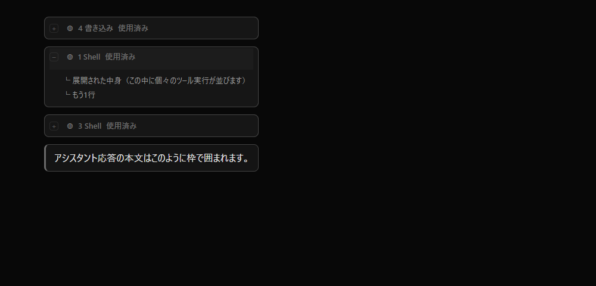

# opencode-desktop-style

> ⚠️ **Unofficial / 非公式** — OpenCode の公式プロジェクトとは無関係の個人ツールです。無保証・自己責任で使用してください。

OpenCode デスクトップアプリに、**「どこが束ねられているか」が分かる枠**と
**開閉マーカー（+ / −）**を追加する非公式 CLI です。

| Before | After |
|---|---|
| ツール実行がベタ並びで、まとまりや開閉状態が分かりにくい | 群ごとに枠で区切られ、先頭の `+`/`−` で開閉が一目で分かる |



## 何をするか

OpenCode デスクトップは Electron アプリで、UI は `app.asar` にバンドルされています。
公式のテーマ機能は**色（パレット）専用**で、枠のようなレイアウト変更はできません。

そこでこのツールは、インストール済みの `app.asar` 内 `out/renderer/index.html` に
`<style id="oc-desktop-overrides">` を **1つだけ注入**します。アプリ本体は再配布しません。

- ツール実行のまとまり: `[data-component="collapsed-tool-group"]`
- アシスタント応答の本文: `[data-component="text-part"]`
- 開閉マーカー: `[data-slot="collapsible-trigger"]` の `aria-expanded` を見て `+` / `−`

色は `currentColor` を `color-mix` した半透明なので、ライト／ダークどのテーマにも馴染みます。

## 必要環境

- Node.js 18 以上
- OpenCode デスクトップ（このツールは起動中のアプリを書き換えません）

## 使い方

### 適用

```bash
# 1) 状態確認
npx -y opencode-desktop-style status

# 2) OpenCode を閉じてから
npx -y opencode-desktop-style apply

# 3) OpenCode を再起動すると反映
```

### 再起動せず先に確認（DevTools）

```bash
npx -y opencode-desktop-style preview
```

出力されたスニペットを、OpenCode の「表示」→「Toggle Developer Tools」→ Console に貼り付けます。

### 元に戻す

```bash
npx -y opencode-desktop-style revert   # アプリを閉じてから
```

初回 `apply` 時に `app.asar.orig` へバックアップされます。

### skill / command を opencode に入れる

```bash
npx -y opencode-desktop-style install-skill
```

`~/.config/opencode/` に以下を配置します（削除は `uninstall-skill`）。

- skills: `opencode-desktop-style`（適用）, `opencode-desktop-style-revert`（元に戻す）
- commands: `/desktop-style`, `/desktop-style-revert`

## アプリ更新後

自動更新で `app.asar` が差し替わると見た目は消えます。
**もう一度 `apply` を実行するだけ**で再適用されます（更新後の素の asar を検知してバックアップを取り直します）。

## CSS をカスタマイズ

既定 CSS は同梱の `css/overrides.css`。自前の CSS を使う場合:

```bash
npx -y opencode-desktop-style apply --css ./my.css
```

`css/overrides.css` の末尾にバリエーション（思考も囲む／応答全体を1枠にする）をコメントで用意しています。

## オプション

```
--asar <path>   app.asar を明示指定（既定はOSごとに自動検出）
--css  <file>   適用する CSS
--entry <path>  注入先 index.html（既定: out/renderer/index.html）
--force         アプリ起動中でも強行（非推奨）
```

## 仕組み

- `app.asar` はヘッダー(JSON)＋連結データ。対象 `index.html` のみ差し替え、他ファイルはバイト単位でそのまま再構築します。
- `apply` は冪等（既存の注入ブロックを差し替え）。素の asar を検知したら `app.asar.orig` を更新します。
- このビルドは `asar` の整合性検証が無効なため、再構築しても起動できます。

## 注意・リスク

- **起動中に書き換えない**こと。遅延読み込みが壊れ、レンダラがクラッシュする恐れがあります。
- 将来 OpenCode が `asar` の整合性検証を有効化すると、改造 `app.asar` が起動拒否される可能性があります。
- 非公式・無保証。問題があれば `revert` で戻すか、アプリを再インストールしてください。
- Windows では未署名スクリプトが SmartScreen/AV に反応することがあります。

## 本家への提案

恒久対応にするなら、この CSS を本家（[sst/opencode](https://github.com/sst/opencode) の `packages/desktop`）に
PR して本体機能にするのが最も筋が良いです。このリポジトリの CSS はその下書きにも使えます。

## License

MIT © furutyX
